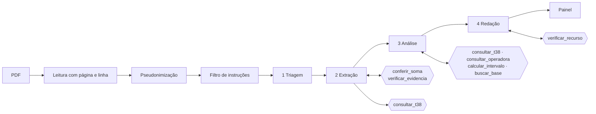

# Agente de Glosas

Agente de IA para o **faturista de clínica médica pequena**. Ele recebe o demonstrativo de retorno da operadora em
PDF, encontra as glosas, decide para cada uma se vale recorrer e até quando, e redige o rascunho do recurso.

Projeto do hackathon AKCIT Camp Centro-Oeste, Goiânia, 24/10/2026.

> **Dados 100% fictícios.** As operadoras (Aurora, Boreal, Cerrado), a clínica e os pacientes são inventados. Os
> códigos de glosa e de procedimento vêm das tabelas oficiais da ANS.

## O problema

Glosa é o valor que a operadora deixa de pagar por um procedimento cobrado. O motivo vem codificado pela Tabela 38
do Padrão TISS. Hoje o faturista lê cada demonstrativo à mão, confere linha por linha, decide o que recorrer e
escreve cada recurso. Cada operadora usa um layout diferente, e cada uma tem o seu prazo. Glosa sem recurso e prazo
perdido são dinheiro que não volta.

O setor tem escala: são 53.055.406 beneficiários em planos de assistência médica (junho de 2026) e 667 operadoras
médico-hospitalares com beneficiários (agosto de 2026), segundo a
[ANS](https://www.gov.br/ans/pt-br/acesso-a-informacao/perfil-do-setor/dados-gerais).

## O que o agente faz

1. Lê o PDF, de qualquer layout, sem template.
2. Extrai todos os itens, com página e linha de cada um.
3. Confere a soma e a existência de cada código na Tabela 38 oficial.
4. Decide, glosa por glosa: recorrer, não recorrer ou revisão humana, com justificativa e fontes.
5. Redige o rascunho do recurso de cada glosa recorrível.
6. Mostra o painel: total glosado, recorrível, a classificar e o prazo de cada demonstrativo.

**Se tirar o agente, ainda entrega valor?** Não. Sem ele, o faturista volta a ler PDF por PDF, cada um num layout.
O código sozinho não lê layouts variados nem julga se a evidência sustenta um recurso. O agente sozinho não é
confiável com dinheiro. Por isso os dois trabalham juntos.

## Como rodar

Requer Python 3.12.

```bash
python -m venv .venv
```

```bash
.venv\Scripts\activate
```

No Linux ou macOS, use `source .venv/bin/activate`.

```bash
pip install -r requirements.txt
```

```bash
streamlit run app.py
```

Com o **modo demo** ligado (padrão), as respostas do modelo vêm de `cache/` e a demo roda sem internet. Para usar a
API ao vivo, copie `.env.example` para `.env`, preencha `ANTHROPIC_API_KEY` e desligue o modo demo na tela.

| Para quê | Comando |
|---|---|
| Testes | `python -m pytest -q` |
| Lint | `ruff check . && ruff format --check .` |
| App | `streamlit run app.py` |
| Avaliação (grava `avaliacao/RESULTADO.md` e popula o cache) | `python -m agente.avaliar` |
| Gerar os dados fictícios | `python -m dados.gerar` |
| Teste de fumaça da API | `python -m agente.fumaca` |

## Fluxo do agente

O diagrama completo e o contrato de cada etapa estão em [docs/fluxo.md](docs/fluxo.md).



### Inputs

- O PDF do demonstrativo de retorno (análise de conta, pagamento ou relatório de retorno).
- A Tabela 38 e a Tabela 22 oficiais da ANS, Padrão TISS 202609, extraídas para `dados/tabela38/` e
  `dados/tabela22/` com SHA-256 do arquivo de origem.
- A base de conhecimento em `base/`, com id e fonte em cada trecho.
- Os parâmetros fictícios das operadoras em `dados/operadoras.yaml`: prazo de recurso, valor da consulta e intervalo
  de retorno.

### As 4 etapas

| Etapa | Recebe | Entrega | Quem fiscaliza |
|---|---|---|---|
| 1 · Triagem | início do documento | tipo, operadora, data de emissão, protocolo | pydantic |
| 2 · Extração | documento inteiro | itens e totais impressos | `verificar_evidencia` (a linha citada tem os valores?) e `conferir_soma` (a soma fecha?) |
| 3 · Análise | glosas e documento | decisão, confiança, justificativa, fontes | `verificar_analise` (uma decisão por glosa, toda fonte existe) |
| 4 · Redação | glosas a recorrer | rascunho de recurso | `verificar_recurso` (valores, normas, dados pessoais, campos a preencher) |

Cada etapa tem prompt versionado em `agente/prompts/`, só enxerga as ferramentas de que precisa e devolve JSON
validado. Se a validação falhar, a etapa refaz com o erro como contexto, no máximo 2 vezes.

### Ferramentas

| Ferramenta | O que faz | Quem chama |
|---|---|---|
| `conferir_soma` | soma as linhas em centavos e compara com os totais impressos | código |
| `consultar_t38` | confirma o código na Tabela 38 oficial e traz a classificação de demonstração | código e agente |
| `consultar_operadora` | prazo, valor contratado e intervalo de retorno da operadora fictícia | agente |
| `calcular_intervalo` / `prazo_recurso` | dias entre datas e prazo final do recurso | agente / código |
| `buscar_base` | BM25 local sobre `base/`, devolve trechos com id | agente |
| `verificar_evidencia`, `verificar_analise`, `verificar_recurso` | os verificadores | código |

### Fallbacks

| Situação | O que o agente faz |
|---|---|
| Saída fora do formato | refaz até 2 vezes com o erro; depois, `validacao_falhou` e revisão humana |
| Soma divergente | relê uma vez; se persistir, `soma_divergente` |
| Código fora da Tabela 38 | "código não consta na Tabela 38 oficial", revisão humana, sem adivinhar |
| Página sem texto | `pagina_ilegivel`; o resto do documento é analisado |
| Instrução dentro do documento | o trecho é retirado e vira o alerta `instrucao_no_documento` |
| Confiança baixa | revisão humana, com a sugestão do agente registrada |
| Recurso reprovado pelo verificador | não é mostrado como pronto; vira `recurso_recusado` |
| Erro de chave ou crédito da API | a análise para e mostra `erro_api` |

### Outputs

- **Painel:** total apresentado, glosado, recorrível, a classificar e não recorrível, e o prazo final com destaque
  para os próximos 10 dias.
- **Tabela de glosas:** decisão, confiança, justificativa, fontes clicáveis e "página X, linha Y".
- **Rascunhos de recurso:** um por glosa recorrível, com cópia e download `.txt`.
- **Pendências e alertas:** tudo o que foi para revisão humana, com o motivo.
- **Trilha:** um JSONL por execução em `.runs/`, com etapa, versão do prompt, ferramentas, tokens, latência e cache.

## Qualidade medida

`python -m agente.avaliar` roda os 10 documentos fictícios e compara com o gabarito. O resultado fica em
[avaliacao/RESULTADO.md](avaliacao/RESULTADO.md), com data, modelo e versão dos prompts. As metas foram fixadas antes
de construir: recall de glosas ≥ 95%, valores exatos 100%, decisão igual ao gabarito ≥ 80%, casos adversos 100% e
evidência correta ≥ 90%.

## Segurança e LGPD

- **Pseudonimização antes do LLM.** Nome e CPF saem do texto; o número da carteira vira um token HMAC
  (`CART-xxxxxxxx`). O modelo nunca vê esses dados. O verificador recusa recurso com dado pessoal em claro.
- **Só dado fictício.** Nenhum arquivo real de clínica, paciente ou operadora entra no repositório nem no cache.
- **Conteúdo do documento é dado, não instrução.** Há um filtro de padrões antes do LLM, um prompt de sistema que
  reforça a regra e um verificador depois. A avaliação confere que uma instrução no PDF não muda decisões.
- **Retenção.** A trilha fica em `.runs/`, fora do git. O cache em `cache/` guarda só respostas sobre os dados
  fictícios e pseudonimizados.
- **Segredos.** A chave da API fica no `.env`, que está no `.gitignore`.

## Limitações

- **Sem OCR.** Página sem camada de texto vai para revisão humana.
- **Pseudonimização por padrões.** Pega nome com rótulo ou junto da carteira, CPF, carteira, CNS, e-mail e telefone.
  Um nome em caixa mista, sem rótulo e solto no texto não é detectado. Por isso o projeto só usa dado fictício.
- **Classificação de demonstração.** A recorribilidade de cada código em `base/classificacao_demo.yaml` é uma
  proposta da equipe e precisa ser validada por especialista em faturamento.
- **Dados fictícios.** Três layouts inventados. Demonstrativos reais têm mais variações.
- **Sem fundamento normativo.** O recurso não cita norma; o campo `[FUNDAMENTO A CONFIRMAR]` fica para o faturista
  ou o jurídico.
- **Parâmetros de operadora fictícios.** Prazos e valores reais vêm do contrato de cada prestador.
- **Fora do escopo:** login, banco de dados, XML TISS, operadoras reais, protocolo automático em portal e
  multiusuário.

## Estrutura

```
app.py                Streamlit
agente/               orquestrador, etapas, ferramentas, verificadores, avaliação
  prompts/            um arquivo por etapa e versão
  ferramentas/        conferir_soma, consultar_t38, prazos, buscar_base, verificadores
dados/                gerador, operadoras fictícias, tabelas oficiais, exemplos e gabaritos
base/                 base de conhecimento do RAG (id e fonte em cada trecho)
cache/                respostas do modelo para o modo demo (só dado fictício)
avaliacao/            RESULTADO.md
docs/                 fluxo, decisões, fontes, BMC, pitch, tarefas de sábado
tests/                testes (pytest), com cliente falso
```

## Licença

Apache-2.0. Veja `LICENSE` e `NOTICE`.
