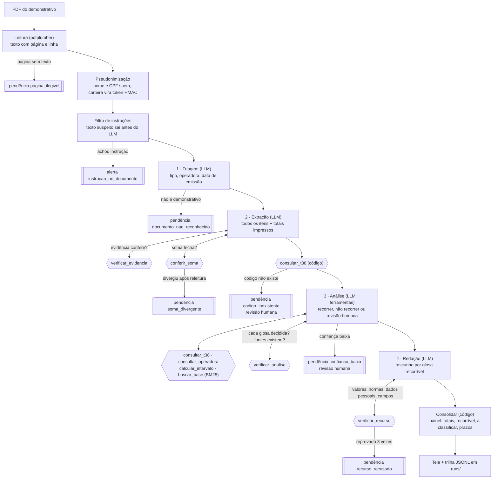

# Fluxo do agente

Princípio: **o agente faz o trabalho e ferramentas determinísticas fiscalizam o agente.** O LLM decide o que exige
leitura e julgamento: extração, enquadramento e redação. O código decide o que exige certeza: soma, existência do
código, prazo, evidência e totais do painel.

Losangos duplos são código, não LLM. Em qualquer etapa do LLM, se a saída não validar, a etapa refaz com o erro
como contexto, no máximo 2 vezes. Depois disso, o caso vai para revisão humana com o motivo.

## Contrato de cada etapa

| Etapa | Recebe | Ferramentas | Devolve (validado por pydantic) | Fiscalização pelo código |
|---|---|---|---|---|
| Leitura | PDF | — | linhas `(página, linha, texto)` | página com menos de 20 caracteres vira `pagina_ilegivel`; PDF corrompido vira `documento_nao_reconhecido` |
| Pseudonimização | linhas | — | linhas com `[NOME]`, `[CPF]` e `CART-xxxxxxxx` | a numeração de página e linha não muda |
| Filtro de instruções | linhas | — | linhas sem o trecho suspeito | alerta com página, linha e trecho |
| 1 · Triagem | primeiras 40 linhas | — | `Triagem`: tipo, operadora, competência, data de emissão, protocolo | data válida; tipo `demonstrativo_retorno` para seguir |
| 2 · Extração | documento inteiro | — | `Extracao`: itens com página, linha, guia, data, token, procedimento, valores e código de glosa; totais impressos | valores no formato BRL viram centavos (`parse_brl`); `verificar_evidencia` confere cada linha citada; `conferir_soma` confere soma e totais, com uma releitura |
| Conferência do código | glosas extraídas | `consultar_t38` | existe ou não na Tabela 38 oficial | inexistente nunca vai ao LLM |
| 3 · Análise | itens, glosas, documento | `consultar_t38`, `consultar_operadora`, `calcular_intervalo`, `buscar_base` | `Analise`: decisão, confiança, justificativa, ids das fontes, documentos | `verificar_analise`: uma decisão por glosa e todo id existe na base; confiança baixa vira revisão humana |
| 4 · Redação | glosas a recorrer com a análise | — | `Redacao`: um texto por glosa | `verificar_recurso`: todo valor existe nos dados, nenhuma norma citada, `[FUNDAMENTO A CONFIRMAR]`, protocolo e assinatura `[A PREENCHER]`, nenhum dado pessoal, guia, procedimento e código citados |
| Consolidar | resultado | `prazo_recurso` | painel em centavos e prazo final | 100% código |

## Prompts

Um arquivo por etapa e versão em `agente/prompts/` (`sistema_v1.md`, `triagem_v1.md`, `extracao_v1.md`,
`analise_v1.md`, `redacao_v1.md`). `AGENTE_PROMPTS=analise=v2` troca a versão de uma etapa. A versão entra na chave
do cache e na trilha.

## Casos adversos

| Caso | Documento | O que acontece |
|---|---|---|
| Total impresso ≠ soma das linhas | `adverso_soma.pdf` | `conferir_soma` diverge, o agente relê uma vez, a divergência persiste e vira `soma_divergente` |
| Código fora da Tabela 38 | `adverso_codigo.pdf` | o código não existe, a glosa vai para revisão humana com "código não consta na Tabela 38 oficial" |
| Instrução no documento | `adverso_injecao.pdf` | o filtro retira o trecho, gera `instrucao_no_documento` e o prompt de sistema reforça que o documento é dado |
| Página só com imagem | `adverso_imagem.pdf` | a página 2 não tem texto e vira `pagina_ilegivel`; a página 1 é analisada |

## Trilha

Cada execução grava `.runs/<data>_<documento>.jsonl`, fora do git. Cada linha tem a etapa, a versão do prompt, o
modelo, as ferramentas chamadas com argumento e resultado resumidos, os tokens, a latência e se veio do cache. A
última linha resume custo, pendências e alertas.
